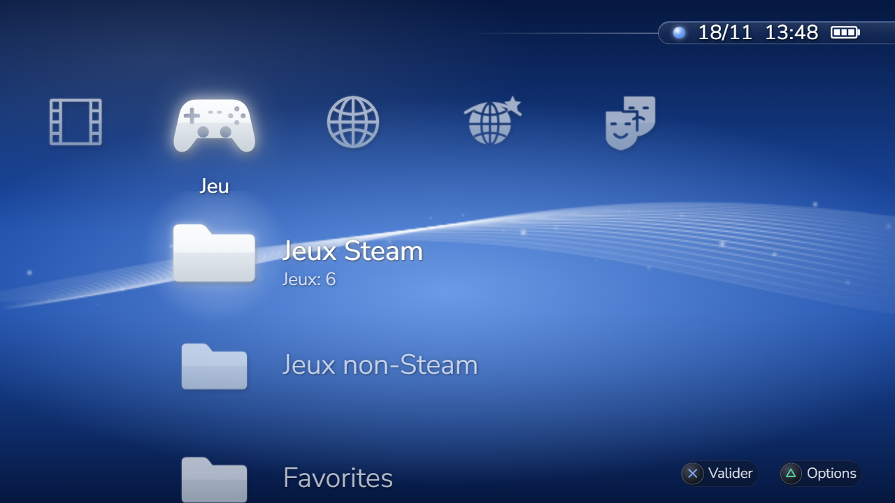
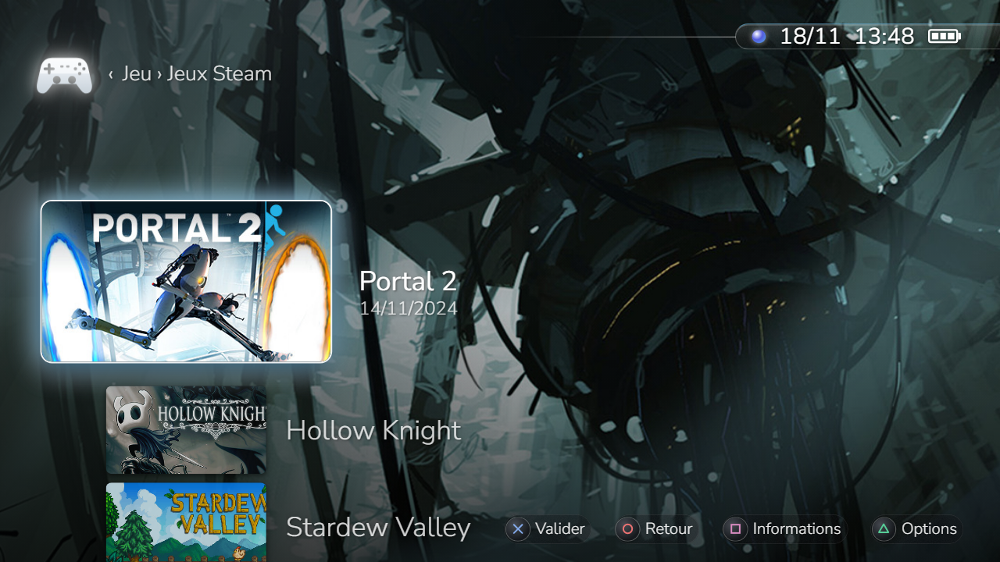
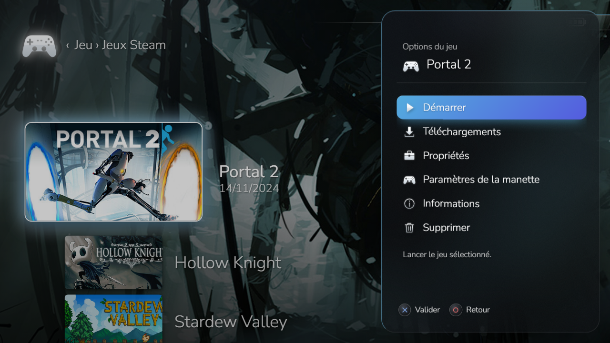

# PS3 XMB · Glass Dusk

L'interface de la PlayStation 3 pour Steam, mariée au verre fumé et aux couleurs dynamiques de
[Glass Dusk](https://github.com/Yareli0i/glass-dusk). Deux pièces qui se complètent :

Le **même XMB** existe en deux versions, selon l'outil que vous utilisez :

| | Version Decky (`ps3-xmb-0.2.7.zip`) | Version Millennium (`ps3-xmb-glass-dusk-millennium-0.2.7.zip`) |
|---|---|---|
| Pour | **Steam Deck** (mode Jeu), Big Picture sur PC via Decky | **PC** (Windows / Linux) : Steam bureau **et** Big Picture |
| Menu XMB PS3 à l'accueil | ✅ | ✅ (Big Picture) |
| Catégories, jeux, collections, options △, réglages, langues, glyphes | ✅ | ✅ |
| Verre Glass Dusk et accent tiré de l'art du jeu dans le XMB | ✅ | ✅ |
| Fond PS3 animé (couleur du mois + vague) | Dans le XMB | Dans le XMB, **tout Big Picture** et **Steam bureau** |
| Glass Dusk sur le reste de Steam (bibliothèque, magasin, menus, overlay) | — | ✅ (36 réglages) |
| Photo | Captures Steam + dossier Images | Captures Steam |
| Vidéo | Enregistrements Steam + dossier Vidéos | — (nécessite le backend de Decky) |

**Sur PC, la version Millennium suffit** : elle apporte le XMB en Big Picture sans installer Decky. Si les deux sont installés, c'est le XMB de Decky qui s'affiche et celui de Millennium s'efface.

Basé sur [PSP XMB](https://github.com/timskap/psp-xmb) de Tim et [Glass Dusk](https://github.com/Yareli0i/glass-dusk) de Yareli (licences MIT).

**Téléchargements : [dernière release](https://github.com/LempereurTom/ps3-xmb/releases/latest)**
- `ps3-xmb-0.2.7.zip` → plugin Decky (XMB, Steam Deck + Big Picture PC)
- `ps3-xmb-glass-dusk-millennium-0.2.7.zip` → thème Millennium (Steam bureau)

**➜ [Guide d'installation pas à pas](#installation-pas-à-pas)** (Steam Deck, PC Big Picture, Steam bureau)



| Liste des jeux (accent tiré de l'art) | Menu Options en verre Glass Dusk |
|---|---|
|  |  |

| Paramètres de thème | Thème bureau (banc d'essai) |
|---|---|
|  |  |

| Autres écrans de Big Picture (Millennium) : fond PS3 et vague |
|---|
|  |

*Captures prises dans l'aperçu navigateur avec des données de démonstration, pas dans Steam.*

## Decky ou Millennium : lequel installer ?

- **Decky Loader** est un lanceur de plugins pour l'interface manette de Steam. C'est l'outil de référence sur **Steam Deck**.
- **Millennium** est un lanceur de thèmes pour Steam sur **PC**. Il s'applique au Steam de bureau et à Big Picture.

| Votre usage | À installer |
|---|---|
| Steam Deck | Version Decky |
| PC (Steam bureau et/ou Big Picture) | Version Millennium |
| PC, et vous voulez aussi les vidéos dans le XMB | Version Millennium + version Decky |

## Installation pas à pas

> **En bref**
> - Steam Deck → [1. Version Decky sur Steam Deck](#1-installer-le-xmb-sur-steam-deck)
> - **PC (bureau + Big Picture, XMB compris) → [3. Version Millennium](#3-installer-le-thème-bureau-millennium)**, le plus simple sur PC
> - PC avec Decky (optionnel, pour les vidéos) → [2. Version Decky sur PC](#2-installer-le-xmb-sur-pc-big-picture-windows)
>
> Les deux fichiers se trouvent dans la [dernière release](https://github.com/LempereurTom/ps3-xmb/releases/latest).

### 1. Installer le XMB sur Steam Deck

**a. Installer Decky Loader** (une seule fois)

1. Appuyez sur **STEAM** → *Alimentation* → **Passer en mode bureau**.
2. Dans le navigateur, ouvrez [decky.xyz](https://decky.xyz) et téléchargez l'installeur.
3. Lancez le fichier téléchargé et choisissez la version **Release** (stable).
4. Revenez au mode Jeu avec l'icône *Return to Gaming Mode* du bureau.
5. Appuyez sur le bouton **…** : une nouvelle icône en forme de **prise** apparaît dans le menu rapide. C'est Decky.

**b. Activer le mode développeur de Decky** (nécessaire pour installer un plugin hors catalogue)

1. **…** → icône prise → **roue dentée** (paramètres de Decky).
2. *Général* → activez **Mode développeur**.

**c. Installer PS3 XMB**

Le plus simple est d'installer directement depuis l'adresse :

1. Paramètres de Decky → onglet **Développeur** → **Installer un plugin depuis une URL**.
2. Saisissez :
   ```
   https://github.com/LempereurTom/ps3-xmb/releases/download/v0.2.7/ps3-xmb-0.2.7.zip
   ```
3. Validez, puis confirmez l'installation.

Si vous préférez passer par le fichier : en mode bureau, téléchargez `ps3-xmb-0.2.7.zip` depuis la [release](https://github.com/LempereurTom/ps3-xmb/releases/latest). Ensuite, onglet **Développeur** → **Installer un plugin depuis un fichier ZIP** et choisissez-le dans *Téléchargements*.

**d. Activer l'accueil PS3**

1. **…** → icône prise → **PS3 XMB**.
2. Activez **Accueil PS3**. Le bouton **Ouvrir le XMB** permet aussi de l'essayer sans remplacer l'accueil.
3. Appuyez sur **STEAM** → *Accueil* : le XMB s'affiche.

Pour revenir à l'accueil Steam normal : **…** → PS3 XMB → **Rétablir l'accueil Steam**, ou dans le XMB *Paramètres → Paramètres système → Accueil Steam standard*.

### 2. Installer le XMB sur PC (Big Picture, Windows)

> Inutile si vous installez la version Millennium (étape 3) : elle contient déjà le XMB pour Big Picture. Decky sur PC sert seulement si vous voulez aussi la catégorie Vidéo.

⚠️ Decky Loader sur Windows **n'est pas supporté officiellement** par ses auteurs ([wiki Decky](https://wiki.deckbrew.xyz/en/user-guide/windows-installation)). Ça fonctionne, mais une mise à jour de Steam peut le casser temporairement.

**a. Préparer Steam**

1. Fermez complètement Steam (clic droit sur l'icône près de l'horloge → *Quitter*).
2. Ouvrez le dossier de Steam (par défaut `C:\Program Files (x86)\Steam`).
3. Créez un fichier vide nommé exactement **`.cef-enable-remote-debugging`**. Dans l'Explorateur : *Nouveau → Document texte*, puis renommez-le en supprimant aussi le `.txt`. Les extensions de fichiers doivent être visibles (*Affichage → Afficher → Extensions de noms de fichiers*).

**b. Lancer Decky**

1. Sur la [page des releases de Decky Loader](https://github.com/SteamDeckHomebrew/decky-loader/releases), téléchargez l'archive **PluginLoader Win** de la dernière version stable et décompressez-la.
2. Lancez **`PluginLoader_noconsole.exe`** (ou `PluginLoader.exe` pour voir les messages).
3. Relancez Steam puis passez en **Big Picture**.
4. Ouvrez le menu rapide (bouton **Guide/Xbox + A** à la manette, ou **Ctrl + 2** au clavier) : l'icône **prise** de Decky doit apparaître.

Decky ne fonctionne que **tant que `PluginLoader` est lancé**. Pour qu'il démarre avec Windows, appuyez sur **Win + R**, tapez `shell:startup` et placez-y un raccourci vers `PluginLoader_noconsole.exe`.

**c. Installer et activer PS3 XMB**

Suivez les étapes **1.b**, **1.c** et **1.d** ci-dessus : c'est la même chose dans Big Picture. Dans le XMB, **Utilisateurs → Quitter Big Picture** ramène au Steam de bureau.

**d. Optionnel : Photo et Vidéo**

Ces deux catégories lisent vos captures et enregistrements Steam ainsi que vos dossiers Images et Vidéos. Sur PC, elles ont besoin de **[Python 3](https://www.python.org/downloads/)**. Pendant l'installation de Python, cochez *Add python.exe to PATH*. Les vignettes de vidéos utilisent `ffmpeg` s'il est installé. Tout le reste du XMB fonctionne sans.

### 3. Installer le thème bureau (Millennium)

**a. Installer Millennium** (une seule fois)

1. Allez sur [steambrew.app](https://steambrew.app), téléchargez l'installeur pour votre système et lancez-le. Sous Linux, suivez les instructions de la page.
2. Lancez Steam : Millennium s'ajoute à Steam, et un menu **Millennium** apparaît dans les paramètres de Steam.

**b. Ajouter le thème**

1. Téléchargez **`ps3-xmb-glass-dusk-millennium-0.2.7.zip`** depuis la [release](https://github.com/LempereurTom/ps3-xmb/releases/latest).
2. Décompressez-le : vous obtenez un dossier **`PS3-XMB`**.
3. Placez ce dossier dans le dossier des thèmes de Millennium :
   - **Windows** : `C:\Program Files (x86)\Steam\millennium\themes\`
   - **Linux** : `~/.steam/steam/millennium/themes/`

   Vérifiez que le fichier `skin.json` se trouve **directement** dans `themes\PS3-XMB\`, et non dans `themes\PS3-XMB\PS3-XMB\`.
4. Redémarrez Steam complètement (*Steam → Quitter*, puis relancez).

**c. Activer et régler le thème**

1. Paramètres de Steam → **Millennium** → **Thèmes**.
2. Choisissez **PS3 XMB · Glass Dusk**.
3. Cliquez sur **⋯ → Paramètres** pour tout personnaliser : l'onglet **PS3** (XMB en Big Picture, fond, couleur, vague, accent, teinte du verre) et les onglets Apparence, Bibliothèque, Big Picture et overlay, Plugins, Couleurs.
4. Les réglages s'appliquent **au redémarrage de Steam**.
5. Ouvrez **Big Picture** (icône manette en haut à droite de Steam) : l'accueil est le XMB PS3. Les réglages du XMB lui-même (couleur, langue, glyphes, panneaux…) sont dans *Paramètres* du XMB, comme sur PS3.

Dans le XMB, *Paramètres → Paramètres système → Accueil Steam standard* le masque jusqu'au prochain démarrage de Big Picture. Pour le désactiver définitivement : onglet PS3 → **XMB en Big Picture : Désactivé**.

Si la bibliothèque reste d'aspect Steam d'origine alors que le magasin est bien thématisé : quittez Steam complètement, relancez-le, puis dans Millennium passez à un autre thème et revenez à celui-ci. Voir aussi la section dépannage du [README de Glass Dusk](desktop-theme/PS3-XMB/README.glass-dusk.md).

### Mettre à jour

- **XMB** : réinstallez le nouveau ZIP par l'URL ou le fichier (étape 1.c) ; vos réglages sont conservés.
- **Thème bureau** : remplacez le dossier `PS3-XMB` par le nouveau, puis redémarrez Steam.

### Désinstaller

- **XMB** : **…** → PS3 XMB → *Rétablir l'accueil Steam*, puis paramètres de Decky → *Plugins* → PS3 XMB → **Désinstaller**. Aucun fichier de Steam ni de jeu n'est modifié.
- **Thème bureau** : Millennium → Thèmes → choisissez un autre thème (ou celui par défaut), puis supprimez le dossier `PS3-XMB`.

### Dépannage

| Problème | Solution |
|---|---|
| L'icône prise de Decky n'apparaît pas | Redémarrez Steam. Sur PC, vérifiez que `PluginLoader` tourne et que le fichier `.cef-enable-remote-debugging` existe. |
| Le XMB affiche une erreur puis l'accueil Steam revient | Le plugin s'est désactivé tout seul pour ne pas bloquer Steam. Réactivez **Accueil PS3** ; si ça recommence, ouvrez une [issue](https://github.com/LempereurTom/ps3-xmb/issues). |
| Photo / Vidéo vides sur PC | Installez Python 3 (étape 2.d) puis rechargez le plugin depuis Decky. |
| Ça rame sur un petit PC | Onglet PS3 → **Vague XMB : Fixe**. Dans Apparence, **Verre : Plus dense** réduit aussi l'effet de transparence. |
| Ça rame sur le Deck | Dans le XMB : *Paramètres → Paramètres de thème → Animation de la vague : Désactivé*. |
| Après une mise à jour de Steam, Decky ne s'ouvre plus (Deck) | Passez en mode bureau, déplacez `~/homebrew/plugins/ps3-xmb` hors du dossier `plugins`, puis `sudo systemctl restart plugin_loader`. |

## Le XMB (plugin Decky)

- **Catégories PS3** : Utilisateurs · Paramètres · Photo · Musique · Vidéo · Jeu · Réseau · Steam Network · Amis.
- **Fond PS3** : « Original » change de couleur chaque mois (argent en janvier… rouge en décembre) et s'assombrit le soir ; 13 couleurs fixes en plus.
- **Vague** : ruban de fils lumineux et paillettes, animé à 30 i/s maximum, en pause dès qu'un poster de jeu, le visionneur ou le menu Options la recouvre.
- **Verre Glass Dusk** : menu Options (△) en verre fumé avec grain et bords éclairés, ligne sélectionnée en dégradé d'accent, puces de touches, horloge.
- **Accent** : les deux couleurs de l'art du jeu sélectionné (comme Glass Dusk), ou la couleur PS3. Hors d'un jeu, le menu revient aux couleurs neutres du thème.
- **Touches** : symboles PlayStation ✕ ○ △ □ ou Xbox/Steam A B X Y.
- **Langues** : français (par défaut), anglais, russe.
- **Utilisateurs** : profil, *Quitter Big Picture* (PC uniquement), *Éteindre le système*.
- **Section Jeu dans l'ordre d'usage** : Récemment joués (5 derniers par défaut, 10 ou 20 dans *Paramètres de jeu*) · Jeux installés · Favoris · vos collections · Tous les jeux (alphabétique) · Jeux non-Steam · Téléchargements · Bibliothèque Steam. Les dossiers vides sont masqués ; les jeux non installés sont atténués et proposent l'installation. Captures dans Photo. *Paramètres de jeu → Jeux affichés* permet de n'afficher que les jeux installés.
- **Panneaux XMB** à la place des pages Steam, dans le même verre que le menu Options :
  - **Profil** (Utilisateurs ou Amis → Mon profil) : avatar, pseudo, statut modifiable (En ligne, Absent, Invisible, Hors ligne), amis en ligne, invitations, jeux possédés.
  - **Informations d'un jeu** (□ ou Options → Informations) : temps de jeu, ces deux semaines, dernière session, date d'achat, taille, Metacritic, avis, et les actions du jeu.
  - **Téléchargements** : jeu en cours, progression, vitesse, temps restant, file d'attente.
  - Chaque panneau garde un accès à la page Steam complète.
- **Fond du jeu activé** : l'image du jeu est recadrée, ses bords se fondent dans le ciel PS3 et elle dérive dans un lent zoom.
- **Fond du jeu désactivé** : les couleurs de l'image du jeu (jusqu'à 4, chacune à sa proportion) flottent doucement dans le ciel, et la vague prend une nuance de la principale.
- **Panneaux Steam (Contacts, menu STEAM)** : aux couleurs du thème choisi dans le XMB.
- **Amis et discussions** ouvre le panneau Contacts de Steam, habillé aux couleurs du XMB (police, verre, sélection en couleur d'accent) ; l'heure et les boutons du XMB se décalent pour ne pas passer dessous. Le menu STEAM reçoit le même habillage.

Réglages : **Paramètres → Paramètres de thème** (couleur, panneaux, accent, fond du jeu, animation), **Paramètres système** (langue, touches), **Paramètres audio**, **Paramètres de jeu**. Les principaux sont aussi dans le menu rapide de Decky.

## Le thème bureau (Millennium)

C'est Glass Dusk **en entier**, avec toutes ses options traduites en français (36 réglages : verre, finition, coins, transitions, écran de connexion, veille, accueil et ses statistiques, liste des jeux, magasin, Big Picture, overlay, plugins, plus l'onglet Couleurs), et un onglet **PS3** :

| Réglage PS3 | Valeurs |
|---|---|
| XMB en Big Picture | **Activé** · Désactivé |
| Fond PS3 (bureau et Big Picture) | **Couleur du mois et vague XMB** · Glass Dusk seul |
| Couleur PS3 | **Original (change chaque mois)** · 13 couleurs fixes |
| Vague XMB | **Animée** · Fixe · Masquée |
| Vague au-dessus de l'art du jeu | **oui** · non |
| Accent | **Art du jeu (Glass Dusk)** · Couleur PS3 |
| Teinte du verre | **Couleur PS3** · Onglet Couleurs |
| Assombrir le soir | **oui** · non |

Installation : voir [Installer le thème bureau](#3-installer-le-thème-bureau-millennium) plus haut.

## Performances

- **Bureau** : la vague reste toujours derrière Steam. Elle n'est jamais redessinée pendant qu'elle bouge : deux calques sont peints une fois, un peu plus larges que la fenêtre, puis ondulent par animation CSS (gérée par la carte graphique, fluide). Pendant l'animation, le flou du verre passe à 14 px pour rester léger. Pause quand Steam est réduit, n'a pas le focus (en jeu) ou passe en veille. Sur un petit PC : *Vague XMB : Fixe*.
- **Big Picture (Millennium)** : pas de flou, vague à 30 i/s ; celle de l'arrière-plan s'arrête tant que le XMB (qui a la sienne) est affiché.
- **Vague nette** : dessinée à la résolution réelle de l'écran (jusqu'à 2560 px de large), sur le bureau comme en Big Picture.
- **Démarrage** : en ouvrant Big Picture, l'accueil de Steam n'apparaît jamais avant le XMB (le fond PS3 s'affiche le temps qu'il démarre).
- **XMB** : canevas à mi-résolution (≤ 1100 px), dégradés et sprite pré-calculés (aucune allocation par image), 30 i/s, pause automatique ; les pulsations PS3 n'animent que l'opacité (compositeur, pas de repeint). L'accent est calculé une fois par jeu sur une image de 32×18 px et mis en cache.

## Développement

```sh
npm ci
npm run dev                # aperçu sur http://127.0.0.1:5173
npm test                   # tests TypeScript
python -m unittest discover -s tests -p "test_*.py"
npm run build              # ZIP Decky dans release/
node scripts/check-xmb.mjs <dossier>       # tests headless du XMB (aperçu lancé)
node scripts/check-desktop.mjs <dossier>   # tests headless de la couche PS3 bureau
node scripts/check-bigpicture.mjs <dossier> # XMB Millennium dans une simulation de Big Picture
npm run build:millennium                   # compile ps3/xmb.js (XMB de la version Millennium)
python desktop-theme/tools/build-skin.py   # régénère skin.json (traductions + onglet PS3)
```

## Limites connues

- Le XMB de la version Millennium lit la bibliothèque et la navigation de Steam par `window.opener` (comme Glass Dusk), sans toucher aux modules internes de Steam, et prend la manette via les événements `vgp_onbuttondown` de Big Picture. Vérifié dans un vrai client Steam (Windows, novembre 2026) : affichage, navigation à la manette, fond PS3. Si une touche ne réagit pas dans votre configuration, signalez-le dans les [issues](https://github.com/LempereurTom/ps3-xmb/issues).
- Decky sur Windows est expérimental côté Decky lui-même.
- Le thème bureau dépend des noms de classes lisibles que Millennium (3.4+) rétablit ; voir le README de Glass Dusk dans `desktop-theme/PS3-XMB/README.glass-dusk.md`.
- Les sons sont ceux du pack *PSP Sounds* (SGL-Galaxy) fourni par PSP XMB ; aucun son Sony n'est inclus.

## Crédits

- PSP XMB — Tim (MIT). Glass Dusk — Yareli (MIT), traduction française de Glass Dusk par Warzox.
- Nunito Sans et JetBrains Mono — SIL OFL 1.1.
- Icônes : recréations originales ; aucun logo PlayStation n'est utilisé.
