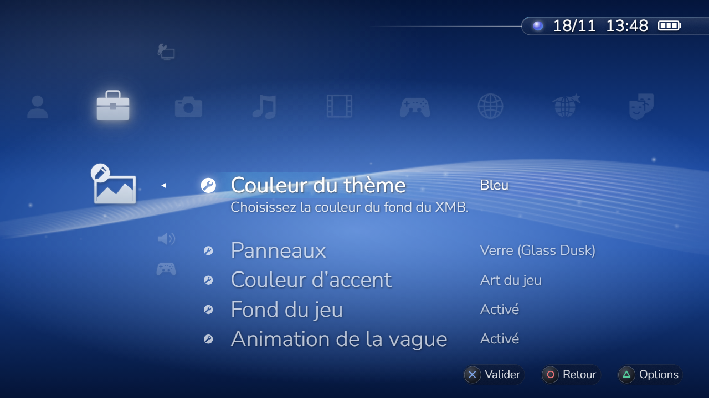
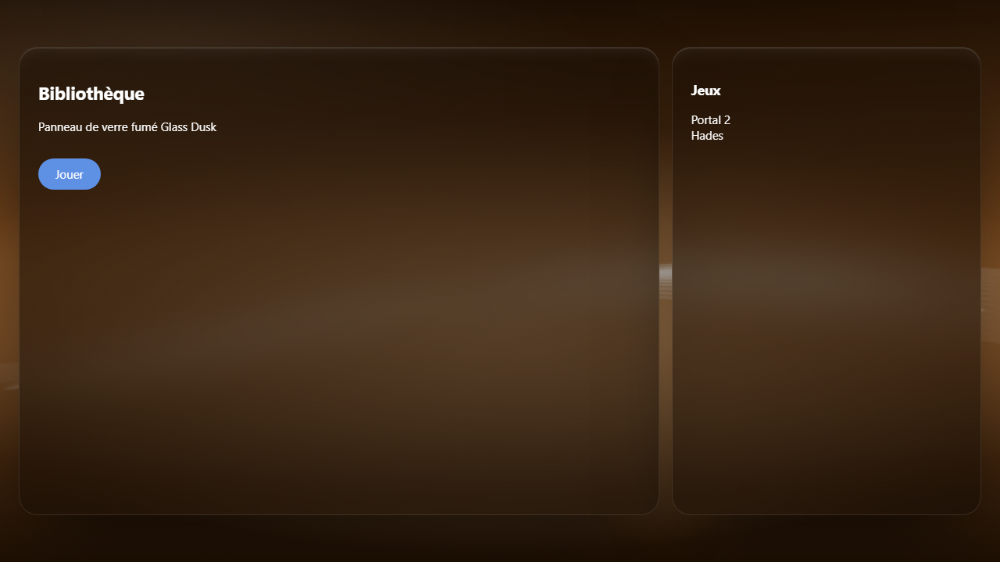

# PS3 XMB · Glass Dusk

L'interface de la PlayStation 3 pour Steam, mariée au verre fumé et aux couleurs dynamiques de
[Glass Dusk](https://github.com/Yareli0i/glass-dusk). Deux pièces qui se complètent :

| Où | Quoi | Outil |
|---|---|---|
| **Steam Deck (mode Jeu)** et **Big Picture sur PC** | Le XMB PS3 remplace l'accueil de Steam : barre de catégories, vague lumineuse, couleur du mois, panneaux en verre, accent tiré de l'art du jeu | Plugin [Decky Loader](https://github.com/SteamDeckHomebrew/decky-loader) (`release/ps3-xmb-0.1.0.zip`) |
| **Steam bureau** (Windows / Linux) et le reste de Big Picture | Glass Dusk complet (bibliothèque, magasin, menus, overlay, Big Picture) posé sur le fond PS3 : couleur du mois, vague XMB, verre teinté | Thème [Millennium](https://steambrew.app) (`desktop-theme/PS3-XMB`) |

Basé sur [PSP XMB](https://github.com/timskap/psp-xmb) de Tim et [Glass Dusk](https://github.com/Yareli0i/glass-dusk) de Yareli (licences MIT).

**Téléchargements : [dernière release](https://github.com/LempereurTom/ps3-xmb/releases/latest)**
- `ps3-xmb-0.1.0.zip` → plugin Decky (XMB, Steam Deck + Big Picture PC)
- `ps3-xmb-glass-dusk-millennium-0.1.0.zip` → thème Millennium (Steam bureau)


| Liste des jeux (accent tiré de l'art) | Menu Options en verre Glass Dusk |
|---|---|
|  |  |

| Paramètres de thème | Thème bureau (banc d'essai) |
|---|---|
|  |  |

*Captures prises dans l'aperçu navigateur avec des données de démonstration, pas dans Steam.*

## Decky ou Millennium : lequel installer ?

- **Decky Loader** est un lanceur de plugins pour l'interface manette de Steam (mode Jeu du Steam Deck = Big Picture sur PC). Il permet de **remplacer l'accueil** par le vrai menu XMB.
- **Millennium** est l'équivalent pour le **Steam de bureau** : il applique des thèmes qui **habillent** l'interface existante.

| Votre usage | À installer |
|---|---|
| Steam Deck | Plugin Decky |
| PC, Steam classique uniquement | Thème Millennium |
| PC, Steam classique + Big Picture | Les deux (XMB en accueil Big Picture, Glass Dusk PS3 partout ailleurs) |

## Le XMB (plugin Decky)

- **Catégories PS3** : Utilisateurs · Paramètres · Photo · Musique · Vidéo · Jeu · Réseau · Steam Network · Amis.
- **Fond PS3** : « Original » change de couleur chaque mois (argent en janvier… rouge en décembre) et s'assombrit le soir ; 13 couleurs fixes en plus.
- **Vague** : ruban de fils lumineux et paillettes, animé à 30 i/s maximum, en pause dès qu'un poster de jeu, le visionneur ou le menu Options la recouvre.
- **Verre Glass Dusk** : menu Options (△) en verre fumé avec grain et bords éclairés, ligne sélectionnée en dégradé d'accent, puces de touches, horloge.
- **Accent** : les deux couleurs de l'art du jeu sélectionné (comme Glass Dusk), ou la couleur PS3.
- **Touches** : symboles PlayStation ✕ ○ △ □ ou Xbox/Steam A B X Y.
- **Langues** : français (par défaut), anglais, russe.
- **Utilisateurs** : profil, *Quitter Big Picture* (PC uniquement), *Éteindre le système*.
- Bibliothèque Steam réelle, collections en dossiers, captures et enregistrements dans Photo/Vidéo, jeux non-Steam.

Réglages : **Paramètres → Paramètres de thème** (couleur, panneaux, accent, fond du jeu, animation), **Paramètres système** (langue, touches), **Paramètres audio**, **Paramètres de jeu**. Les principaux sont aussi dans le menu rapide de Decky.

### Installation sur Steam Deck

1. Installez Decky Loader, activez le *Mode développeur* dans ses réglages.
2. Téléchargez `ps3-xmb-0.1.0.zip` depuis les [releases](https://github.com/LempereurTom/ps3-xmb/releases/latest), puis Decky → Développeur → **Installer un plugin depuis un ZIP**.
3. … → Decky → PS3 XMB → activez **Accueil PS3** (ou *Ouvrir le XMB*).

### Installation sur PC (Big Picture, Windows)

Decky Loader fonctionne sur Windows de façon **non officielle** ([wiki Decky](https://wiki.deckbrew.xyz/en/user-guide/windows-installation)) :

1. Téléchargez l'archive *PluginLoader Win* des releases Decky et lancez `PluginLoader.exe` (ou `PluginLoader_noconsole.exe`). Il doit rester lancé ; ajoutez-le au démarrage si vous voulez.
2. Créez le fichier vide `.cef-enable-remote-debugging` dans le dossier de Steam s'il n'existe pas, puis redémarrez Steam.
3. Ouvrez Big Picture, installez le ZIP comme sur le Deck.
4. Pour Photo et Vidéo, installez [Python 3](https://www.python.org/downloads/) (le reste fonctionne sans). Les vignettes vidéo utilisent `ffmpeg` s'il est dans le PATH.

Sans batterie (PC de bureau), l'indicateur de batterie disparaît.

## Le thème bureau (Millennium)

C'est Glass Dusk **en entier**, avec toutes ses options traduites en français (42 réglages : verre, finition, coins, transitions, écran de connexion, veille, accueil et ses statistiques, liste des jeux, magasin, Big Picture, overlay, plugins, plus l'onglet Couleurs), et un onglet **PS3** :

| Réglage PS3 | Valeurs |
|---|---|
| Fond PS3 | **Couleur du mois et vague XMB** · Glass Dusk seul |
| Couleur PS3 | **Original (change chaque mois)** · 13 couleurs fixes |
| Vague XMB | **Fixe (recommandé)** · Animée · Masquée |
| Vague au-dessus de l'art du jeu | **oui** · non |
| Accent | **Art du jeu (Glass Dusk)** · Couleur PS3 |
| Teinte du verre | **Couleur PS3** · Onglet Couleurs |
| Assombrir le soir | **oui** · non |

Installation : téléchargez `ps3-xmb-glass-dusk-millennium-0.1.0.zip` depuis les [releases](https://github.com/LempereurTom/ps3-xmb/releases/latest) et décompressez son dossier `PS3-XMB` dans `Steam/millennium/themes/` (ou copiez `desktop-theme/PS3-XMB` de ce dépôt), puis Millennium → Thèmes → *PS3 XMB · Glass Dusk*. Les réglages s'appliquent au redémarrage de Steam.

## Performances

- **Bureau** : le verre de Glass Dusk est un flou d'arrière-plan ; tout ce qui bouge derrière l'oblige à recalculer ce flou. La vague est donc **fixe par défaut** (dessinée une seule fois, 0 coût). En mode *Animée* : 15 i/s, en pause quand Steam n'a pas le focus (en jeu), est réduit ou en veille. Aucune lecture de style à chaque image.
- **XMB** : canevas à mi-résolution (≤ 1100 px), dégradés et sprite pré-calculés (aucune allocation par image), 30 i/s, pause automatique ; les pulsations PS3 n'animent que l'opacité (compositeur, pas de repeint). L'accent est calculé une fois par jeu sur une image de 32×18 px et mis en cache.

## Développement

```sh
npm ci
npm run dev                # aperçu sur http://127.0.0.1:5173
npm test                   # tests TypeScript
python -m unittest discover -s tests -p "test_*.py"
npm run build              # ZIP Decky dans release/
node scripts/check-xmb.mjs <dossier>       # tests headless du XMB (aperçu lancé)
node scripts/check-desktop.mjs <dossier>   # tests headless de la couche PS3 bureau
python desktop-theme/tools/build-skin.py   # régénère skin.json (traductions + onglet PS3)
```

## Limites connues

- Non testé dans un vrai client Steam depuis cette session : l'aperçu navigateur et les bancs d'essai headless ne reproduisent pas Steam. Vérifiez sur votre machine.
- Decky sur Windows est expérimental côté Decky lui-même.
- Le thème bureau dépend des noms de classes lisibles que Millennium (3.4+) rétablit ; voir le README de Glass Dusk dans `desktop-theme/PS3-XMB/README.md`.
- Les sons sont ceux du pack *PSP Sounds* (SGL-Galaxy) fourni par PSP XMB ; aucun son Sony n'est inclus.

## Crédits

- PSP XMB — Tim (MIT). Glass Dusk — Yareli (MIT), traduction française de Glass Dusk par Warzox.
- Nunito Sans et JetBrains Mono — SIL OFL 1.1.
- Icônes : recréations originales ; aucun logo PlayStation n'est utilisé.
